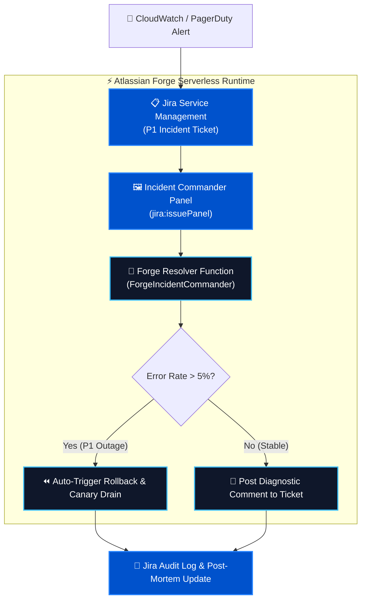

# 🚀 Forge Incident Commander — Codegeist 2026

[](https://developer.atlassian.com/platform/forge/)
[](https://www.typescriptlang.org)
[](https://devpost.com)
[](./test)

> **Built for [Codegeist 2026 (Devpost)](https://devpost.com)**  
> *Timeline: October 27 – December 22, 2026 • Prize Pool: $120,000*

Forge Incident Commander is an autonomous SRE triage and auto-remediation app for Jira Cloud. Operating natively within the Atlassian Forge serverless runtime, it continuously analyzes high-severity (P1) incident tickets, assesses real-time production error rates, and triggers automated rollbacks and canary drains while maintaining a complete audit trail in Jira comments.

---

## 🏛️ System Architecture



---

## 🚀 Quickstart & Verification

```bash
# 1. Run automated test suite
npm test

# 2. Build production Forge distribution
npm run build
```
